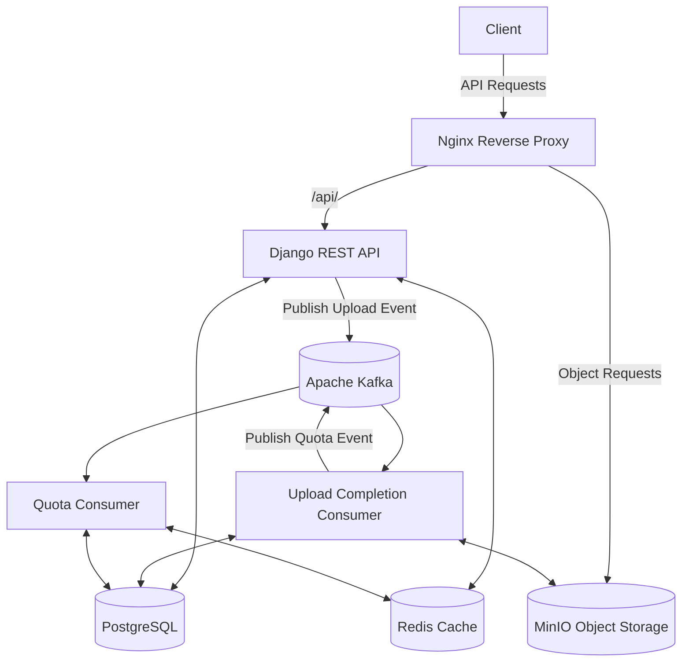
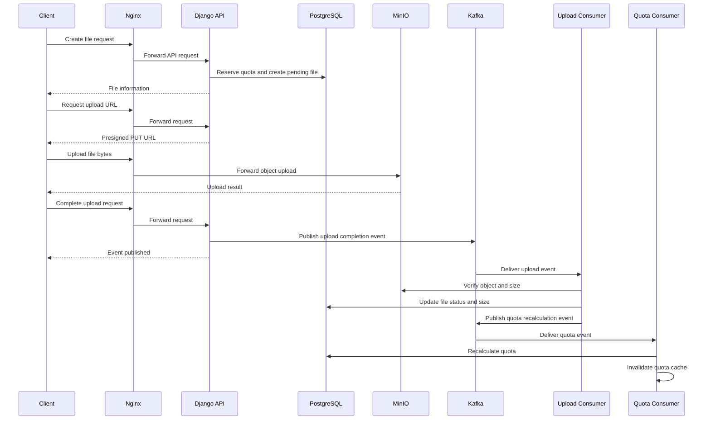
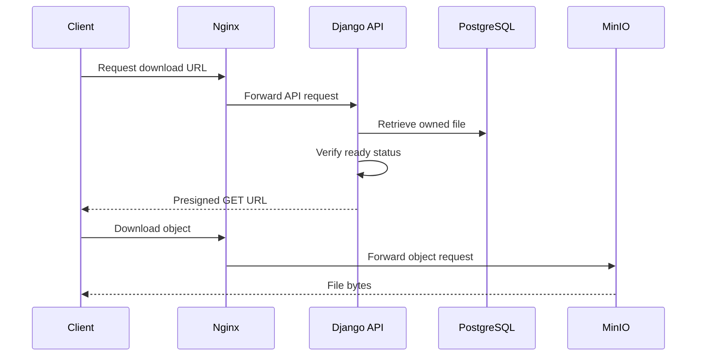

# System Architecture

## 1. Overview

Personal Cloud Drive is a distributed file storage application built with Django REST Framework and several supporting services.

The system separates API processing, metadata storage, object storage, asynchronous event processing, and caching.

The main components are:

- Django REST Framework: API and business logic
- PostgreSQL: Persistent metadata and quota storage
- MinIO: File object storage
- Apache Kafka: Asynchronous event messaging
- Upload Consumer: Processes upload completion events
- Quota Consumer: Recalculates user storage usage
- Redis: Caching
- Nginx: HTTP reverse proxy and object storage gateway

## 2. System Components

### 2.1 Django API

The API is responsible for:

- User registration and JWT authentication
- Folder and file metadata management
- File ownership validation
- Storage quota validation and reservation
- Generating presigned upload and download URLs
- Publishing Kafka events
- Invalidating relevant Redis cache entries

Django does not handle file bytes directly. Clients transfer file contents directly to MinIO through Nginx.

### 2.2 PostgreSQL

PostgreSQL stores persistent application data, including:

- User information
- Folder metadata
- File metadata
- User storage quota information

File records contain metadata such as owner, folder, storage key, declared size, actual size, and upload status.

### 2.3 MinIO

MinIO is used as the object storage service.

Each file is stored using a unique storage key. The database stores this key as a reference to the corresponding MinIO object.

Django generates presigned URLs so clients can upload and download objects without sending file contents through the API.

### 2.4 Apache Kafka

Kafka is used for asynchronous communication between the API and background consumers.

The application uses two event types:

- `file.upload.completed`
- `quota.recalculate`

### 2.5 Consumers

**Upload Completion Consumer**

A separate Django management command continuously consumes upload completion events.

Its responsibilities include:

1. Receiving an upload completion event.
2. Retrieving the corresponding file record.
3. Verifying that the object exists in MinIO.
4. Checking the actual object size.
5. Updating the file status to `ready` or `failed`.
6. Publishing a quota recalculation event.

**Quota Consumer**

A separate management command consumes quota recalculation events.

It recalculates the user's storage usage based on file records and updates the quota information in PostgreSQL.

It also invalidates the corresponding Redis quota cache.

### 2.6 Redis

Redis is used to cache:

- User quota information
- Folder file lists

The application invalidates relevant cache entries when file or quota data changes.

### 2.7 Nginx

Nginx acts as the HTTP entry point.

It routes:

- `/api/` requests to the Django API.
- Object storage requests to MinIO.

This allows file uploads and downloads to bypass Django while keeping API requests centralized.

## 3. System Architecture Diagram

## 4. File Upload Flow

The upload process is asynchronous and consists of the following steps:

1. The client sends a file creation request to Django.
2. Django validates the requested file size and checks the user's available quota.
3. Django reserves the required quota and creates a file record with `pending` status.
4. The client requests a presigned upload URL.
5. Django generates a temporary presigned PUT URL.
6. The client uploads the file directly to MinIO through Nginx.
7. The client calls the complete-upload endpoint.
8. Django publishes a `file.upload.completed` event to Kafka.
9. The upload consumer receives the event and verifies the uploaded object.
10. The consumer updates the file status and actual file size.
11. A `quota.recalculate` event is published.
12. The quota consumer recalculates the user's storage usage.

## 5. File Download Flow

1. The client requests a download URL.
2. Django retrieves the file using the authenticated user's ownership scope.
3. Django verifies that the file status is `ready`.
4. Django generates a presigned GET URL.
5. The client downloads the file directly from MinIO through Nginx.

## 6. Storage Quota Management

Each user has a storage quota with the following values:

- `quota_limit_bytes`: Maximum allowed storage capacity.
- `used_bytes`: Storage occupied by completed files.
- `reserved_bytes`: Storage reserved for pending uploads.

When a new file is created, the application reserves its declared size.

After upload completion, the quota consumer recalculates usage based on file records.

When a file is deleted, a quota recalculation event is published so the user's quota can be updated.

## 7. Caching Strategy

The application uses Redis with a cache-aside approach.

Cached data includes:

- User quota information
- Folder file lists

When relevant data changes, the corresponding cache entries are invalidated to prevent stale data from being served.

## 8. Docker Compose Services

The application runs using Docker Compose.

| Service | Responsibility |
|---|---|
| `api` | Django API served by Gunicorn |
| `postgres` | Persistent relational database |
| `minio` | Object storage |
| `kafka` | Event broker |
| `redis` | Cache |
| `nginx` | HTTP reverse proxy |
| `complete-upload-consumer` | Processes upload completion events |
| `quota-consumer` | Processes quota recalculation events |
| `migrate` | Applies Django database migrations |
| `minio-init` | Ensures the MinIO bucket exists |

All application services communicate through the Docker Compose network.