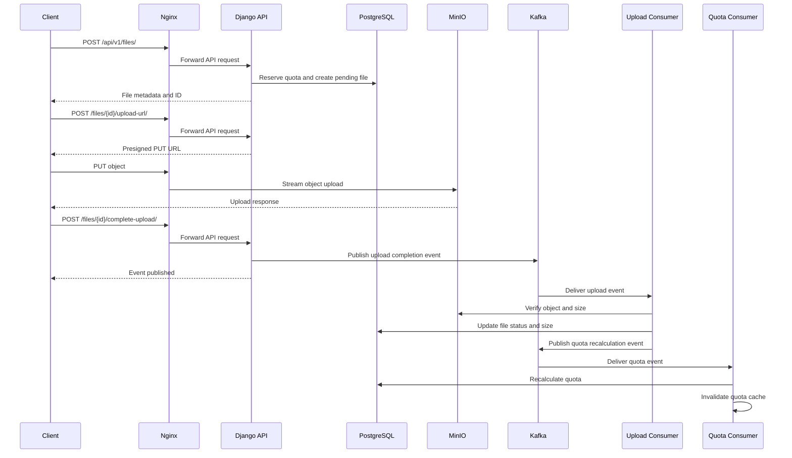
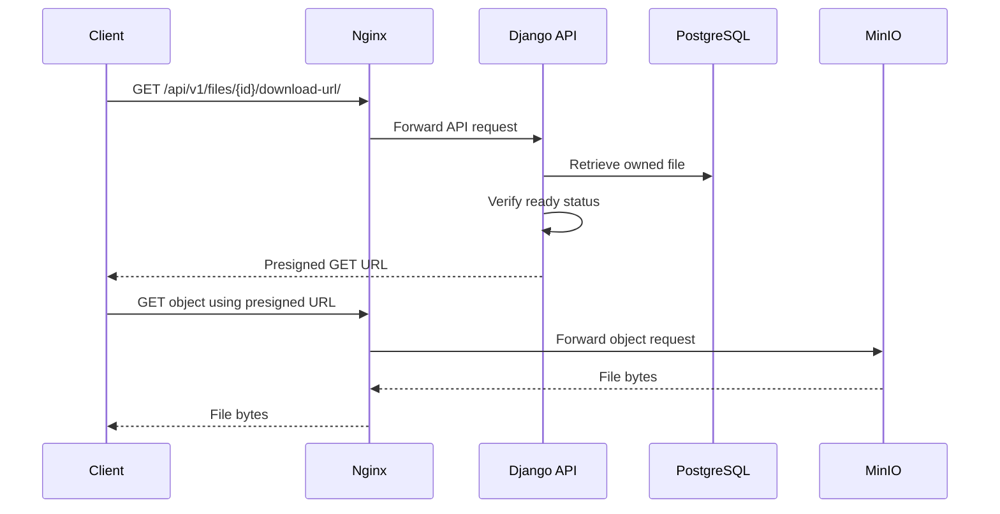

# System Architecture

## 1. Overview

Personal Cloud Drive is a distributed file storage application built with Django REST Framework and several supporting services.

The system separates API processing, metadata storage, object storage, asynchronous event processing, and caching.

The main components are:

- Django REST Framework: API and business logic
- PostgreSQL: Persistent metadata and quota storage
- MinIO: Object storage
- Apache Kafka: Asynchronous event messaging
- Upload Completion Consumer: Processes upload completion events
- Quota Consumer: Recalculates user storage usage
- Redis: Caching
- Nginx: HTTP reverse proxy and object storage gateway

## 2. System Components

### 2.1 Django API

The API is responsible for:

- User registration and JWT authentication
- Folder and file metadata management
- File ownership validation
- Storage quota validation and reservation
- Generating presigned upload and download URLs
- Publishing Kafka events
- Invalidating relevant Redis cache entries

Django does not handle file bytes directly. Clients transfer file contents directly to MinIO through Nginx.

The API is served by Gunicorn inside the Docker environment.

### 2.2 PostgreSQL

PostgreSQL stores persistent application data, including:

- User information
- Folder metadata
- File metadata
- User storage quota information

File records contain metadata such as owner, folder, storage key, declared size, actual size, and upload status.

The file status is used to represent the upload lifecycle:

- `pending`: File metadata has been created and quota has been reserved.
- `ready`: The object has been verified successfully.
- `failed`: The uploaded object did not pass verification.

### 2.3 MinIO

MinIO is used as the object storage service.

Each file is stored using a unique storage key. The database stores this key as a reference to the corresponding MinIO object.

Django generates presigned URLs so clients can upload and download objects without sending file contents through the API.

Two MinIO clients are used:

- Internal client: Uses the Docker network endpoint to communicate with MinIO from Django and background consumers.
- Public client: Generates presigned URLs using the externally accessible Nginx endpoint.

This distinction allows internal service communication while ensuring that clients receive URLs they can access.

### 2.4 Apache Kafka

Kafka is used for asynchronous communication between the API and background consumers.

The application uses two configured topics:

- Upload completion topic, configured through `KAFKA_UPLOAD_COMPLETED_TOPIC`.
- Quota recalculation topic, configured through `KAFKA_QUOTA_RECALCULATE_TOPIC`.

The event type identifies the purpose of an event, while the Kafka topic determines where the event is published.

The upload completion event type used by the API is `file.upload.complete`.

The quota recalculation event type is `quota.recalculate`.

### 2.5 Consumers

The application has two independent Django management commands.

**Upload Completion Consumer**

Command:

```bash
python manage.py consume_upload_events
```

Responsibilities:

1. Receive an upload completion event.
2. Extract the file ID, owner ID, storage key, and declared size.
3. Retrieve the corresponding file record.
4. Verify the object in MinIO using `stat_object`.
5. Compare the actual object size with the declared size.
6. Set the file status to `ready` if the sizes match, or `failed` otherwise.
7. Remove the object from MinIO if the size does not match.
8. Invalidate the folder file-list cache.
9. Publish a quota recalculation event.

**Quota Consumer**

Command:

```bash
python manage.py consume_quota_events
```

Responsibilities:

1. Receive a quota recalculation event.
2. Extract the owner ID.
3. Recalculate the user's storage usage.
4. Update quota information in PostgreSQL.
5. Invalidate the user's quota cache.

The consumers run independently from the API service in Docker Compose.

## 3. Nginx Routing and Proxy Configuration

Nginx is the public HTTP entry point for both API requests and object storage requests.

The routing rules are defined in `nginx/nginx.conf`.

### 3.1 API Proxy

Requests whose path starts with `/api/` are forwarded to the Django API service:

```nginx
location /api/ {
    proxy_pass http://api:8000;

    proxy_http_version 1.1;

    proxy_set_header Host $http_host;
    proxy_set_header X-Real-IP $remote_addr;
    proxy_set_header X-Forwarded-For $proxy_add_x_forwarded_for;
    proxy_set_header X-Forwarded-Proto $scheme;
}
```

The `api:8000` address refers to the API service inside the Docker network.

The `Host` header is preserved using `$http_host`. This is important for MinIO presigned URL signature validation when requests are routed through Nginx.

### 3.2 Object Storage Proxy

All requests that do not match `/api/` are forwarded to MinIO:

```nginx
location / {
    proxy_pass http://minio:9000;

    proxy_http_version 1.1;

    proxy_set_header Host $http_host;
    proxy_set_header X-Real-IP $remote_addr;
    proxy_set_header X-Forwarded-For $proxy_add_x_forwarded_for;

    proxy_request_buffering off;
    proxy_buffering off;

    proxy_connect_timeout 60s;
    proxy_send_timeout 300s;
    proxy_read_timeout 300s;
}
```

The MinIO service receives the original request path and the presigned query parameters.

Request and response buffering are disabled so that Nginx can stream file data instead of buffering the complete file.

The longer send and read timeouts allow large file transfers.

### 3.3 Why This Routing Is Used

The architecture separates metadata operations from file data transfer.

- API requests are processed by Django.
- Upload and download data requests are forwarded directly to MinIO.
- Django only generates and validates metadata-related operations and presigned URLs.

As a result, Django workers do not need to handle large file bodies.

## 4. File Upload Flow

The upload process is asynchronous and consists of the following steps:

1. The client sends a file creation request to Django.
2. Django validates the requested file size and checks the user's available quota.
3. Django reserves the required quota and creates a file record with `pending` status.
4. The client requests a presigned upload URL.
5. Django generates a temporary presigned PUT URL using the public MinIO client.
6. The client uploads the file directly to MinIO through Nginx.
7. The client calls the complete-upload endpoint.
8. Django publishes an upload completion event to Kafka.
9. The upload consumer receives the event and verifies the uploaded object.
10. The consumer updates the file status and actual file size.
11. A quota recalculation event is published.
12. The quota consumer recalculates the user's storage usage.

### Upload Sequence Diagram



## 5. File Download Flow

The download process uses a presigned GET URL.

1. The client requests a download URL.
2. Django retrieves the file using the authenticated user's ownership scope.
3. Django verifies that the file status is `ready`.
4. Django generates a presigned GET URL using the public MinIO client.
5. The client sends a GET request to the returned URL.
6. Nginx forwards the object request to MinIO.
7. MinIO returns the file bytes directly to the client through Nginx.

The actual file contents are never transferred through Django.

### Download Sequence Diagram



## 6. Kafka Event Contracts

Events use a common structure:

```json
{
  "event_id": "unique-event-id",
  "event_type": "event.type",
  "occurred_at": "2026-11-19T10:00:00+00:00",
  "payload": {}
}
```

### 6.1 Upload Completion Event

Published by the Django API after the client calls the complete-upload endpoint.

Topic: `KAFKA_UPLOAD_COMPLETED_TOPIC`

Event type: `file.upload.complete`

Example:

```json
{
  "event_id": "unique-event-id",
  "event_type": "file.upload.complete",
  "occurred_at": "2026-11-19T10:00:00+00:00",
  "payload": {
    "file_id": 12,
    "owner_id": 5,
    "storage_key": "unique-storage-key",
    "declared_size_bytes": 1024
  }
}
```

The consumer uses these fields to locate and verify the uploaded object.

### 6.2 Quota Recalculation Event

Published after upload processing or file deletion.

Topic: `KAFKA_QUOTA_RECALCULATE_TOPIC`

Event type: `quota.recalculate`

Example:

```json
{
  "event_id": "unique-event-id",
  "event_type": "quota.recalculate",
  "occurred_at": "2026-11-19T10:00:00+00:00",
  "payload": {
    "owner_id": 5,
    "reason": "upload_completed",
    "file_id": 12
  }
}
```

The `reason` field identifies why recalculation was requested, for example:

- `upload_completed`
- `file_deleted`

The quota consumer uses `owner_id` to recalculate the corresponding user's quota.

## 7. Kafka Producer Strategy

Event publishing is implemented in `files/kafka_producer.py`.

The producer configuration includes:

```python
KafkaProducer(
    bootstrap_servers=settings.KAFKA_BOOTSTRAP_SERVERS.split(","),
    value_serializer=lambda m: json.dumps(m).encode("utf-8"),
    acks="all",
    retries=5,
)
```

The strategy includes:

- JSON serialization for event messages.
- `acks="all"` to wait for acknowledgment from all required in-sync replicas.
- `retries=5` to retry failed producer sends.
- `future.get(timeout=10)` to wait for the send result and surface errors.
- Closing the producer after publishing.

The application creates a producer for each publishing operation.

The upload completion endpoint publishes the upload event. The upload consumer and file deletion endpoint publish quota recalculation events.

Producer retries handle certain broker and network failures during sending. They do not provide a transaction between PostgreSQL and Kafka.

The application does not currently implement a transactional outbox. Therefore, a database operation and its corresponding Kafka publication are not guaranteed to be atomic.

## 8. Consumer Retry and Idempotency

Both consumers use manual offset commits:

```python
enable_auto_commit=False
```

The offset is committed only after the event processing function completes successfully.

### 8.1 Retry Behavior

If processing raises an exception before `consumer.commit()` is reached, the message offset is not committed.

When the consumer resumes or restarts with the same consumer group, Kafka can deliver that message again.

This provides at-least-once delivery behavior rather than exactly-once processing.

The upload consumer verifies the file's current status before performing the MinIO verification step. This status check is intended to prevent unnecessary processing of files that are no longer pending.

### 8.2 Idempotency Considerations

Events contain a unique `event_id`, but the current implementation does not persist processed event IDs in a dedicated deduplication table.

The upload consumer also uses the file status as part of its processing guard.

The quota recalculation operation is based on the current database state: it calculates the sum of ready file sizes and pending declared sizes. Repeating a successful recalculation therefore produces the same quota values when the underlying file records have not changed.

However, the current implementation does not provide a complete exactly-once guarantee or durable event-level deduplication.

In particular, event processing and offset commit are separate operations. A failure after database changes but before offset commit can cause redelivery.

There is no configured dead-letter topic or separate delayed retry mechanism in the current implementation.

## 9. Storage Quota Management

Each user has a quota record containing:

- `quota_limit_bytes`: Maximum allowed storage capacity.
- `used_bytes`: Storage occupied by completed files.
- `reserved_bytes`: Storage reserved for pending uploads.

The default quota is configurable through `DEFAULT_QUOTA_MB`.

When a new file is created:

1. The user's quota record is locked using `select_for_update()`.
2. Available capacity is calculated.
3. If sufficient space exists, the declared file size is added to `reserved_bytes`.
4. A pending file record is created.

The quota consumer recalculates the values using the file records:

- `used_bytes` is the sum of `size_bytes` for ready files.
- `reserved_bytes` is the sum of `declared_size_bytes` for pending files.

The recalculation is performed inside a database transaction and locks the user's quota record.

## 10. Redis Caching Strategy

The application uses Redis through Django's cache framework with a cache-aside strategy.

The configured default cache timeout is 300 seconds.

Two types of data are cached.

### 10.1 User Quota Cache

Key format:

```text
user:{owner_id}:quota
```

Example:

```text
user:5:quota
```

Cached data contains:

```json
{
  "quota_limit_bytes": 104857600,
  "used_bytes": 1024,
  "reserved_bytes": 2048,
  "available_bytes": 104854528
}
```

The quota service follows these steps:

1. Read the quota key from Redis.
2. If the key exists, return the cached value.
3. Otherwise, retrieve the quota record from PostgreSQL.
4. Calculate available bytes.
5. Store the result in Redis for 300 seconds.

The quota cache is invalidated after quota recalculation.

### 10.2 Folder File List Cache

Key format:

```text
user:{owner_id}:folder:{folder_id}:files
```

Example:

```text
user:5:folder:12:files
```

The cache stores serialized file-list data for a particular user's folder.

The list endpoint uses the cache when a folder ID is supplied in the query parameters.

If the cache entry does not exist, the API retrieves the files from PostgreSQL, serializes them, and stores the result for 300 seconds.

### 10.3 Cache Invalidation

The application invalidates cache entries when relevant data changes.

| Operation | Invalidated key |
|---|---|
| File creation | Folder file-list key |
| File update | Folder file-list key |
| File deletion | Folder file-list key |
| Upload completion processing | Folder file-list key |
| Quota recalculation | User quota key |

Folder file-list invalidation is implemented in `files/cache_utils.py`.

Quota cache invalidation is implemented in `quota/models.py`.

Cache keys include the owner ID to prevent cached data from being shared between different users.

## 11. Docker Compose Services

The application runs using Docker Compose.

| Service | Responsibility |
|---|---|
| `api` | Django API served by Gunicorn |
| `postgres` | Persistent relational database |
| `minio` | Object storage |
| `minio-init` | Ensures the storage bucket exists |
| `kafka` | Event broker |
| `redis` | Cache storage |
| `nginx` | API and object storage reverse proxy |
| `migrate` | Applies database migrations |
| `complete-upload-consumer` | Processes upload completion events |
| `quota-consumer` | Processes quota recalculation events |

The API and consumers use internal Docker service names to communicate with PostgreSQL, Redis, Kafka, and MinIO.

External clients access the API and object storage through Nginx.

## 12. Database Migrations

Database schema changes are maintained through Django migrations.

Migration files are committed to the repository and applied during deployment by the migration service:

```bash
python manage.py migrate
```

The migration service runs before the API and consumer services start.

